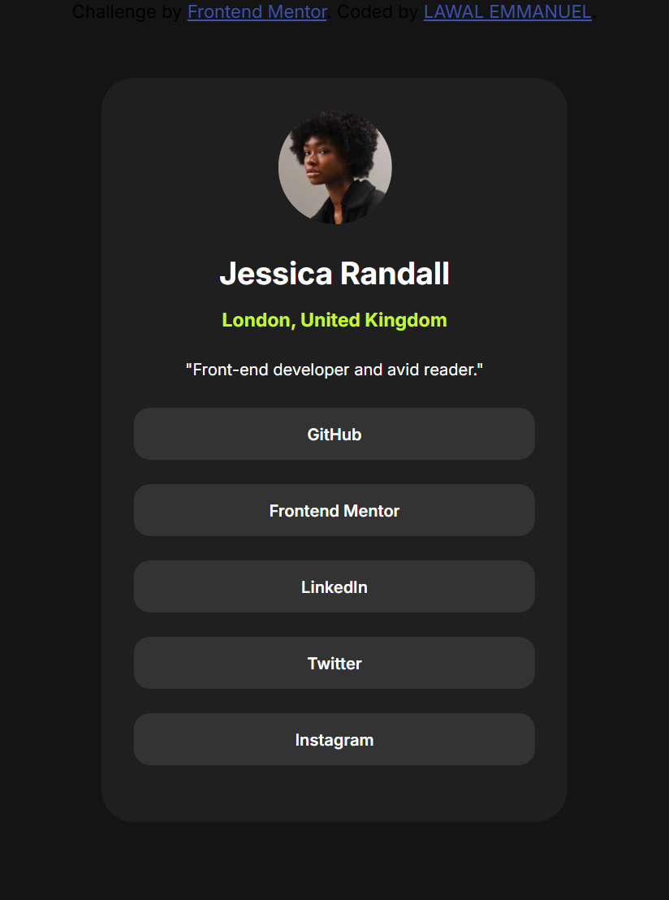

# Frontend Mentor - Social links profile solution

This is a solution to the [Social links profile challenge on Frontend Mentor](https://www.frontendmentor.io/challenges/social-links-profile-UG32l9m6dQ). Frontend Mentor challenges help you improve your coding skills by building realistic projects. 

## Table of contents

- [Overview](#overview)
  - [The challenge](#the-challenge)
  - [Screenshot](#screenshot)
  - [Links](#links)
- [My process](#my-process)
  - [Built with](#built-with)
  - [What I learned](#what-i-learned)
  - [Continued development](#continued-development)
  - [Useful resources](#useful-resources)
  - [AI Collaboration](#ai-collaboration)
- [Author](#author)
- [Acknowledgments](#acknowledgments)

**Note: Delete this note and update the table of contents based on what sections you keep.**

## Overview

### The challenge

Users should be able to:

- See hover and focus states for all interactive elements on the page

### Screenshot

### Links

- Solution URL: [Add solution URL here](https://www.w3schools.com/)
- Live Site URL: [Add live site URL here](https://social-link-page-1.vercel.app/)

## My process

### Built with

- Semantic HTML5 markup
- CSS custom properties
- Mobile-first workflow

### What I learned

in this section, i learnt how to use css max width and min-width. 
### Continued development

i want to continue focusing on building projects and keep on leaning more about programming. i also wish to know more about javascript , react and also backend development.

### Useful resources

- [Example resource 1](https://www.w3schools.com/) - This helped me in css. I really liked this pattern and will use it going forward.

### AI Collaboration

i used chatGPT in desktop development of this project. i used it when i need more information on max-width.

- What tools did you use (i use chatGPT)?
- How did you use them (i use it in desktop development to help me out in min-width and max-width)

## Author

- Website - [Lawal Emmanuel](https://www.your-site.com)
- Frontend Mentor - [@emmyprogrammer](https://www.frontendmentor.io/profile/emmyprogrammer)
